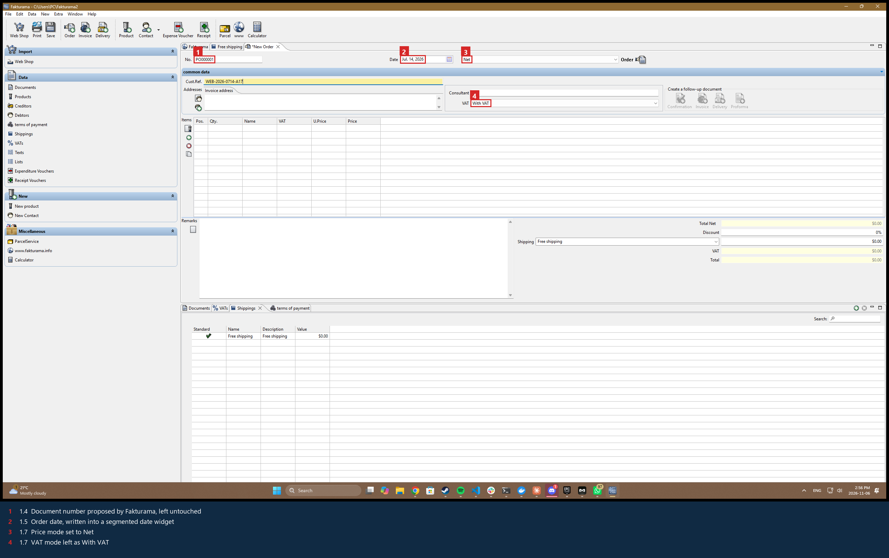
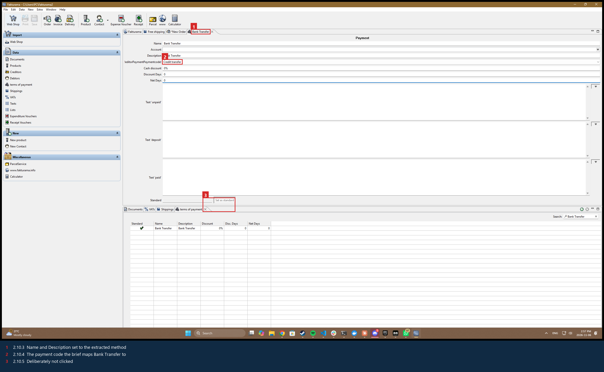
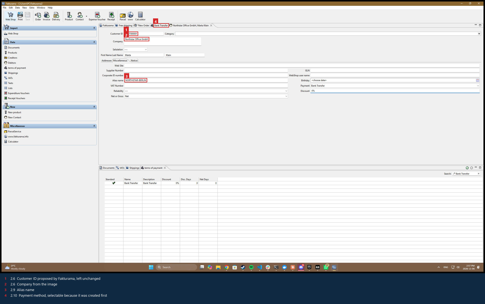
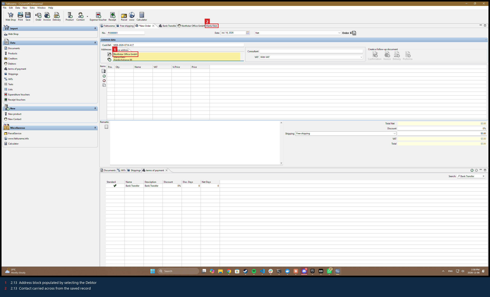
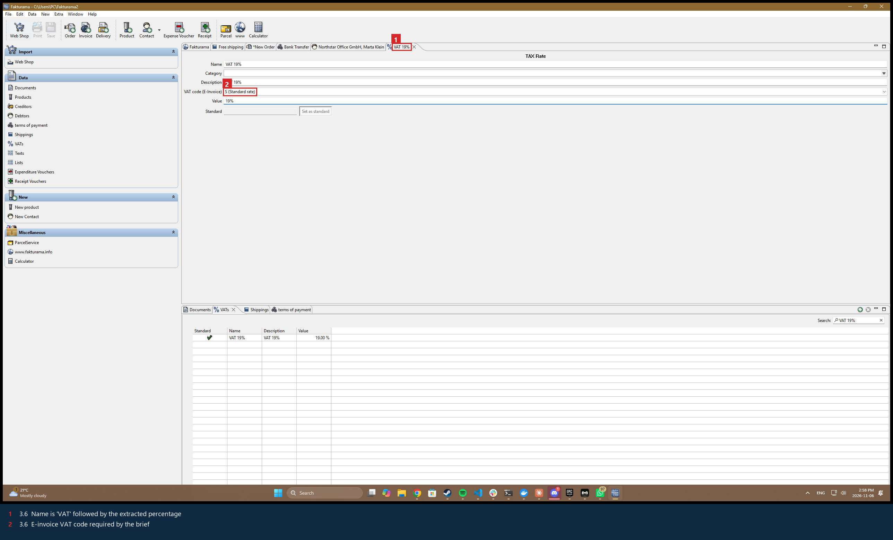
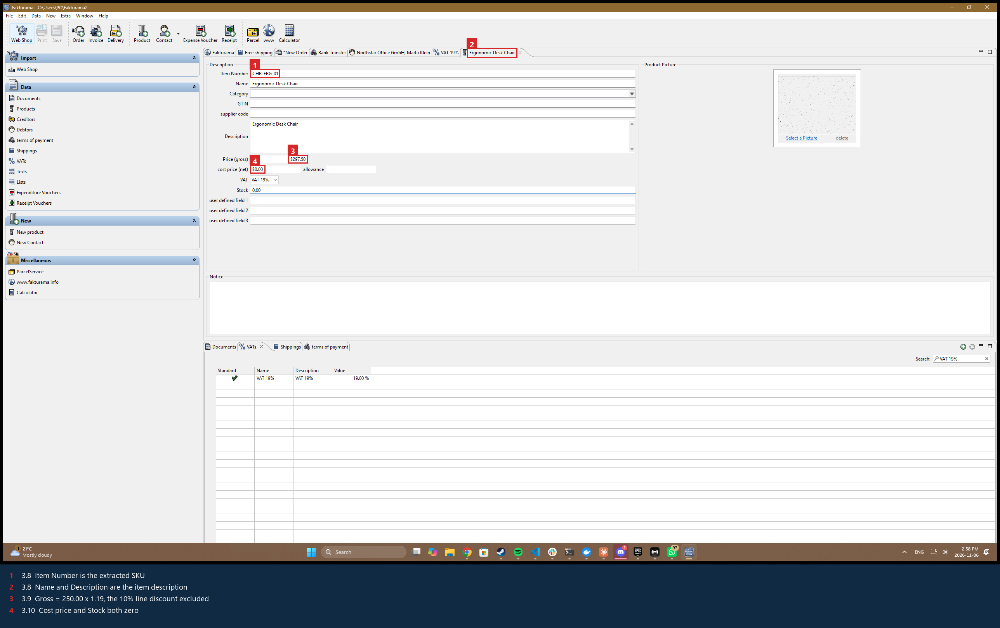
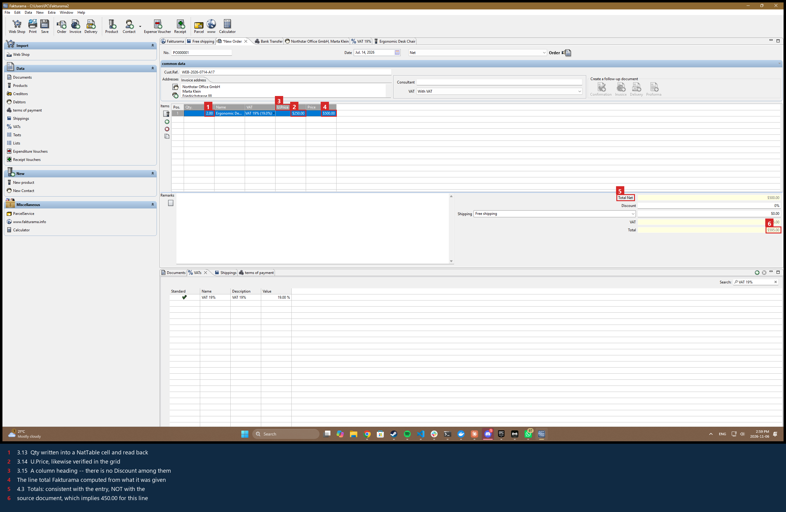

# Fakturama Image-to-Cash Automation

Turns a single order image into a saved, verified **Order** and a linked **Invoice** inside
Fakturama — extracting the source data, resolving or creating the Debtor, payment method,
VAT rates and Products, and applying the extracted payment status. No hardcoded screen
coordinates, no assumption of a fixed window layout.

- **[DESIGN.md](DESIGN.md)** — the design document (Part 1 of the brief).
- **[docs/BRIEF-COVERAGE.md](docs/BRIEF-COVERAGE.md)** — every numbered step of the brief
  mapped to the code that implements it, including the three places where I deliberately
  did something other than the literal instruction, and why.
- **[docs/annotated-extraction.png](docs/annotated-extraction.png)** — what the parser
  actually anchored on, drawn over the source image.
- **[docs/screenshots/](docs/screenshots/)** — the annotated screenshots the brief asks
  for: one numbered capture per stage of a real run, each with the brief step it satisfies
  and what to look at in the image to check it. The final frame is the Order as the
  automation left it, and also the clearest evidence for the one step this build of
  Fakturama cannot perform. Every run rewrites `artifacts/screenshots/`; these are the
  kept copy.

---

## Status: read this first

Run against **Fakturama 2.2.0** on Windows 11, from an empty database each time.

| Part | State |
|---|---|
| Image extraction + validation | **Working**, tested end to end against the supplied order image |
| Test suite | **194 tests, all passing** (`python -m pytest`) |
| Brief stage 1 — New Order + header | **Working against the live application** |
| Brief stage 2 — Debtor, payment method | **Working against the live application** |
| Brief stage 3 — VAT, Product, item lines | **Working up to the line discount**, which this build cannot accept |
| Brief stages 4-5 — save Order, linked Invoice | **Written; not reached**, because the sample stops at the discount |

The flow opens the Order, fills its header, finds no matching Debtor, creates the payment
term and the Debtor, re-selects that Debtor from the still-open Order and confirms the
addresses populated; then per item it creates the VAT rate and the Product, selects the
Product into the Order, and writes the line's Qty and U.Price into the items grid. Every
one of those values is read back and verified — the log is in `artifacts/run.log`.

It then stops, deliberately. **Fakturama 2.2.0's item grid has no Discount column**
(`Pos. │ Qty. │ Name │ VAT │ U.Price │ Price`), and the *Use discount for each item*
preference that should add one has no effect — I verified that four ways, and the evidence
is in [known limitations](#what-i-skipped-and-known-limitations). The sample's first line
carries a 10% discount, so brief step 3.15 cannot be performed on this build with this
document. The run halts there with the reason, the discount it wanted and the columns it
actually found, rather than saving an Order whose totals disagree with the source. A line
with no discount is noted and the run continues.

So the honest summary: **stages 1-3 are proven against the real application; 4-5 are
written and unexercised, blocked behind a missing column rather than behind code I have
not tested.** Pointing the flow at a document whose lines carry no discount would exercise
them, and that is the first thing I would do with more time.

## Setup

Requires **Windows 10/11** and **Python 3.9+** (built and tested on 3.14).

```powershell
git clone https://github.com/Mersal108/Fakturama-Image-to-Cash-Automation.git
cd Fakturama-Image-to-Cash-Automation
python -m pip install -r requirements.txt
```

No OCR engine to install: the default is `Windows.Media.Ocr`, which ships with Windows.
No API key, no network access.

Then install Fakturama — this raises **one UAC prompt, which you must accept**:

```powershell
powershell -ExecutionPolicy Bypass -File scripts\install_fakturama.ps1
```

Launch Fakturama once by hand afterwards and complete its first-run setup (it creates its
database and asks for a workspace folder). The automation does not attempt to drive that
wizard.

Then seed the one piece of master data a workspace cannot do without:

```powershell
python scripts\prepare_workspace.py
```

A Fakturama workspace with no **default shipping method** refuses to open *any* new
document — it raises *"No default value found for Shippings. Please set one from list!"*
and the New Order editor never appears. Fakturama seeds that default during its very first
installation run, so a workspace whose database has been recreated needs it putting back.
The script creates a single zero-cost method and marks it standard, which also matches the
brief's requirement that shipping stay free. Pass `--reset` to move the existing database
aside first (it is **renamed, never deleted**) and start from an empty one.

## Running it

```powershell
# The full flow: image -> Order -> Invoice, verified at each step
python -m fakturama_automation --image samples\order_sample.png

# Just the image pipeline - no Fakturama needed. Start here.
python -m fakturama_automation --image samples\order_sample.png --extract-only

# Write Fakturama's UI Automation tree to artifacts\uia-tree.txt
python -m fakturama_automation --dump-tree
```

Useful flags: `--engine {windows,tesseract,auto}`, `--no-refine` (skip the magnified
per-cell re-read), `--fakturama <path>` (or set `FAKTURAMA_EXE`), `--close`, `--timeout`.

Every run writes to `artifacts/`: `run.log`, `extracted-order.json`, `run-summary.json`,
and a numbered screenshot per step.

**Exit codes:** `0` success · `10` stopped for manual review · `11` extraction failed ·
`12` automation failed · `2`/`3` bad input or Fakturama not found.

## Tests

```powershell
python -m pytest            # 194 tests (~7s; most of that is real OCR)
```

- `test_extraction.py` runs the real OCR engine against `samples/order_sample.png` and
  asserts every extracted field against hand-written ground truth.
- `test_validation.py` is the interesting one: each test corrupts a single value the way
  OCR would — `250.00` read as `256.00`, a dropped discount, a wrong VAT rate — and asserts
  the run stops.
- `test_uia_logic.py` covers the decisions inside the UI layer that do not need a running
  Fakturama: caption normalisation, the label-anchoring geometry, numeric comparison,
  keystroke escaping, date-format inference, and the exact-match rule for selector rows.
  It also covers the screen-reading layer, where most of the live debugging went — which
  recognised line is a header rather than a row, how readings taken at different
  magnifications are merged, which OCR artefacts may be stripped from a cell, and how a
  grid that paints itself is told apart from a pane that merely holds a text box. Each of
  those tests names the live failure it came from.
- `test_normalize.py` / `test_models.py` cover value parsing and the derived prices the
  Fakturama flow writes.

---

## How it works

```
order image
   │
   ├─ 1. EXTRACT    label-anchored OCR; items table re-read cell by cell
   ├─ 2. VALIDATE   arithmetic + business gates  ──► stop for manual review
   │                                                  (nothing has touched Fakturama yet)
   ├─ 3. AUTOMATE   Order-first UIA flow, select-or-create for each record
   └─ 4. VERIFY     read the saved rows back out of Data > Documents
```

### Extraction grounds on labels, not coordinates

Fields are found by asking "what is underneath `ORDER DATE`?" A field's column is bounded
by the labels it shares a row with, so a wide value can never be captured by its neighbour.
The items table's columns are derived from its own header row. Nothing refers to a pixel
position.

`docs/annotated-extraction.png` shows exactly what the parser anchored on — blue for the
labels, green for the values read from them, orange for the derived table columns, purple
for the item rows. Regenerate it with:

```powershell
python tools\annotate_extraction.py samples\order_sample.png docs\annotated-extraction.png
```

### The items table gets a second, closer look

A full-page OCR pass optimises for the page as a whole and reliably drops small isolated
tokens. On the supplied image it loses the `0%` discount on line 2 and the `19%` VAT on
line 1 outright, and reads the `10%` discount as `1096`. Upscaling the whole page does not
fix this — different scales simply drop different cells.

So once the columns are known, each numeric cell is cropped to its own ink and re-read
magnified. Those reads are stable and identical across zoom levels. Windows OCR renders
`%` as `0/0`, which is unambiguous and decoded as such.

### The validation gate is the real safety net

The source document is deliberately redundant: it prints the line items **and** the totals
they add up to. Those must agree, so a single mis-read digit almost always breaks one of:

- per line: `line_net == qty × unit_net × (1 − discount%)`
- `net_total == Σ line_net` · `vat_total == Σ line_net × vat%` · `gross == net + vat`
- payment method maps to a known Fakturama payment code
- `PAID` requires a payment date; anything else must not have one
- no duplicate SKUs, no blank address fields, quantities positive, rates in range

This runs **before Fakturama is launched**. It converts OCR imprecision from a correctness
risk into an availability one: a bad read can stop the run, but it cannot write a
plausible-looking wrong invoice into an accounting system.

### Control discovery: a resolution ladder

Fakturama is Eclipse RCP/SWT, so its widgets are real native controls and UI Automation can
both drive *and read* them. Controls are resolved cheapest-first:

1. **UIA properties** — control type plus name or automation id.
2. **Label anchoring** — SWT text fields frequently expose no accessible name, but the
   visible label beside them is its own element. "The Edit nearest to the right of the Text
   reading `Cust.Ref.`" survives resizing, DPI changes and layout reflow. This is the same
   idea as the OCR parser, applied to a different surface.
3. **Keyboard** — focus plus Tab/F2 where the tree is too thin, always with a read-back.
4. **On-screen text** — last resort; still anchored on words, never on fixed pixels.

A few controls are unnamed icons — notably the pair beside **Addresses**, where the upper
one opens the existing-contact selector and the lower green `+` would start a new Debtor and
skip the existence check entirely. Those are addressed by their relationship to a named
anchor and their visual order among siblings (`flow/widgets.py:icons_near`).

### What UI Automation cannot see, and what to do about it

Two of Fakturama's controls are drawn rather than built, and both are invisible to UI
Automation in the same way. Finding them took most of the live-run time, so they are
written down here in full.

**Nebula NatTable** backs every grid in the application — the contact and product
selectors, the list views, and the Order's own item lines. A NatTable publishes *nothing*:
the pane reports zero children, no Grid or Table pattern, no Value or Text pattern. Every
row a person can plainly read is, to the accessibility tree, not there. Early runs read
"no rows" as "no such record" and happily created duplicates.

**SWT `CCombo`** — the Debtor's payment dropdown — reports itself as an ordinary ComboBox
and then draws its list into a borderless top-level shell that also publishes no children.
Worse, `texts()` on such a combo returns the control's own caption and its chrome, so an
**empty** list reads back as `['Payment', 'Close']`. That is not a missing answer, it is a
wrong one: a caller that trusts it concludes the option exists.

`uia/screen_grid.py` handles both by reading the pixels — the last rung of the resolution
ladder. It screenshots the control, runs the same OCR engine used on the order image,
rebuilds the columns from the header row, and returns rows that are clickable at the text
they were recognised from. Two properties keep this honest:

- **No fixed coordinates.** Column edges come from where the *headers* are drawn, and a row
  is clicked at the centre of its own recognised text. Resize the window or change the font
  and the geometry is simply recomputed.
- **The match rule does not loosen.** OCR widens what can be *seen*; a row read this way is
  still subject to the same exact-match test as one read through UIA. Because screen text
  brings its own confusions — `CUST000001` reads back as `CUSTOOOOOI`, and a truncated cell
  ends in a bullet glyph — comparison is tolerant of `O`/`0` and `I`/`1` *shape* confusions
  and of visual truncation, and of nothing else.

### Combos are populated when their editor is built, not when it is shown

The Debtor's payment method must exist before the Debtor editor is **constructed**. SWT
fills that combo once, at construction; a term of payment created afterwards never appears
in it, and no amount of re-selecting the tab refreshes it. Measured directly: with the
Debtor editor open, creating `Bank Transfer` leaves its dropdown drawing an empty box,
while a Debtor editor opened a moment later offers `Bank Transfer` immediately.

So `flow/payment_terms.py` splits in two. `ensure_payment_term()` runs *before* the New
Contact editor is opened and creates the term if Data ▸ terms of payment does not have it;
`ensure_payment_method()` then does step 2.10 on the open editor and merely selects it.
That reaches the end state the brief describes — the method exists, the Debtor is saved
with it selected — without depending on a refresh the toolkit does not perform.

### Every write is verified

There is no `sleep()` in the flow. Every step waits on a condition — a window exists, a
result list stopped changing, a control became enabled — and every value written is read
back and compared before the flow advances. Creating a Debtor or Product is only considered
done when the still-open Order can find and select it; a Save button click is not evidence.

### Stopping beats guessing

Ambiguity halts the run with a reason, the evidence, and a screenshot
(`ManualReviewRequired`). In an accounting system a confident wrong match — wrong debtor,
wrong VAT rate — costs far more than a paused run.

---

## How the flow works (annotated screenshots)

One capture per stage of a real run, with the values the automation wrote or checked boxed
and numbered. The boxes are not drawn at fixed coordinates: `tools/annotate_run.py` runs
OCR over each screenshot, finds the text itself, and draws around where it actually is, so
the annotations follow the application rather than a remembered layout. Anything it cannot
find is reported in `docs/screenshots/annotated/report.json` rather than drawn in the
wrong place.

Regenerate them with:

```powershell
python -m fakturama_automation --image samples\order_sample.png
python tools\annotate_run.py docs\screenshots
```

### 1 — The Order is opened first, and stays open



Brief 1.3-1.8. The document number Fakturama proposes is left alone, the date goes into a
segmented widget that takes a fixed number of digits per segment, and the price mode is
set to Net. The Items table and address block are still empty — nothing has been invented
yet. **This tab stays open for the rest of the run**, which is what makes every later
"return to the Order" step meaningful.

### 2 — A payment method is created because the extracted one does not exist



Brief 2.10.1-2.10.6. Note the field labelled `!editorPaymentPaymentcode!` — an untranslated
key this build ships with, which is why the selector matches that control by several
possible captions rather than one. It is set to `Credit transfer`, the code the brief maps
`Bank Transfer` to. *Set as standard* is deliberately not clicked.

This runs **before** the Debtor editor opens: SWT fills a combo when its editor is built,
so a term created afterwards never appears in it.

### 3 — The Debtor is created



Brief 2.5-2.11. The tab reads `Northstar Office GmbH, Marta Klein` with **no leading
asterisk** — Fakturama marks unsaved editors with `*`, so this one is saved. The Customer
ID Fakturama proposed is kept.

### 4 — …and then selected back onto the open Order



Brief 2.12-2.13, and the most important check in the stage. The automation cancels out of
the selector, reopens it, searches again, and only accepts the record once it comes back.
**A Save click is not evidence; finding the record again is.**

### 5 — The VAT rate, before the Product that needs it



Brief 3.4-3.6. Checked and created first so the rate exists in the Product's VAT dropdown
(3.7).

### 6 — The Product



Brief 3.8-3.11. The calculation to check is the gross price: `250.00 x 1.19 = 297.50`. The
line's **10% discount is deliberately excluded** from this master price (3.9).

The SKU is worth noting too — OCR reads `CHR-ERG-01` as `CHR-ERG-OI` in this font at every
magnification. It is corrected from the sibling row's digit pattern, and the correction is
reported in `extracted-order.json`, never silent.

### 7 — The line is filled, and the run stops



Brief 3.12-3.14 succeed: Qty and U.Price are written into the NatTable grid and read back.
Then look at the column headings: `Pos. | Qty. | Name | VAT | U.Price | Price`.

**There is no Discount column.** The source document applies 10% to this line and step 3.15
requires entering it.

So the totals shown — net `500.00`, total `595.00` — are arithmetically consistent with
what Fakturama was told, and **wrong against the source document**, which implies `450.00`
for this line. The run stops here rather than save an Order whose totals disagree with the
document it came from. A line carrying no discount is noted and the run continues.

---

## Repository layout

```
fakturama_automation/
  cli.py                  entry point and flags
  config.py               settings; Fakturama discovery
  models.py               typed order document (Decimal money, derived prices)
  errors.py               ManualReviewRequired vs Extraction vs Automation failures
  extraction/
    ocr.py                engines (Windows / Tesseract) + CellReader
    geometry.py           boxes and spatial predicates
    parser.py             label-anchored parsing, items table, derivation fallbacks
    normalize.py          Decimal/percent/date parsing, OCR confusion repairs
    validation.py         the arithmetic and business gates
  uia/
    selectors.py          EVERY Fakturama UI caption, in one place
    locators.py           the resolution ladder
    actions.py            write-then-read-back interactions
    waits.py              condition-based waiting
    app.py                launch/attach, dialogs, UIA tree dump
    screen_grid.py        reads custom-painted grids and dropdowns from pixels
    screenshots.py        per-step capture
  flow/
    runner.py             the whole flow in order
    context.py            step logging, evidence, manual-review stops
    order.py  debtor.py  payment_terms.py  vat.py  product.py  invoice.py  verify.py
    widgets.py            unnamed-icon and date-field helpers
tools/annotate_extraction.py      renders what the parser anchored on
tools/make_sample.py              renders a test document from a JSON spec, and can
                                  mistreat it (tilt, JPEG, low resolution)
scripts/install_fakturama.ps1     downloads and installs Fakturama (one UAC prompt)
scripts/prepare_workspace.py      seeds the default shipping method a new workspace lacks
samples/order_sample.png          the supplied order image
samples/order_no_discount.png     generated: a second customer, no line discounts
samples/order_mixed_vat.png       generated: three lines, two VAT rates, UNPAID
samples/specs/                    the JSON specs those two are rendered from
docs/annotated-extraction.png     the annotated extraction result
docs/screenshots/                 one capture per stage of a real run, plus captions
tests/                            194 tests
```

## Adapting to your Fakturama build

Every caption the automation depends on lives in `fakturama_automation/uia/selectors.py`,
as tuples of acceptable alternatives. The flow logic never hardcodes a string. To adapt:

```powershell
python -m fakturama_automation --dump-tree    # writes artifacts\uia-tree.txt
```

Then match the real names against `selectors.py` and edit that one file.

---

## What I skipped, and known limitations

Stated plainly, as the brief asks.

1. **Fakturama 2.2.0's item grid has no Discount column, so brief step 3.15 cannot be
   performed.** The grid's columns are `Pos. │ Qty. │ Name │ VAT │ U.Price │ Price`, and
   *Documents ▸ Use discount for each item* is already enabled — I toggled it off, on and
   applied, with no effect; there is no header or row context menu and no item-properties
   dialog. The sample's first line carries a 10% discount, so a full run on this sample
   **stops there by design**, with the reason and the columns it actually found. The
   alternative — saving an Order whose totals disagree with the source document — is the
   one outcome an accounting automation must not produce. A zero discount is noted and the
   run continues.
2. **A differing delivery address is flagged, not fully automated.** The brief spells out
   only the case where billing and delivery are identical (give the one Main address both
   roles). The sample document has a *different* delivery address, which genuinely needs a
   second address record. The run records a note rather than silently inventing a procedure
   the brief does not describe.
3. **Reading a grid from the screen inherits OCR's confusions.** `CUST000001` comes back as
   `CUSTOOOOOI` and a narrow cell is truncated to `Northstar Office •`. Matching is
   therefore tolerant of `O`/`0` and `I`/`1` *shape* confusions and of visual truncation,
   and of nothing else — but that tolerance is real, and two records differing only in
   those characters would compare equal. Where UIA exposes the rows, it is used instead.
4. **The SKU correction is a heuristic.** `CHR-ERG-01` reads as `CHR-ERG-OI` in this font at
   every scale and preprocessing variant. It is resolved from a sibling row's digit pattern
   and is always reported in the run notes and `extracted-order.json`. A SKU that genuinely
   ended in letters, in a document whose other SKUs ended in digits, would be corrupted —
   the mitigation is that the correction is visible, never silent.
5. **Fakturama's first-run wizard is not automated**, and a workspace needs
   `scripts/prepare_workspace.py` run once (see [Setup](#setup)).
6. **Only the happy path and the documented stop conditions are covered.** No retry after a
   partial save, no resume of an interrupted run, no concurrent-instance handling.
7. **Tesseract is implemented but not exercised** — the binary could not be installed here,
   so `--engine tesseract` is untested.
8. **Only one document layout is supported.** The parser targets the TJM "SALES ORDER INPUT"
   family. Labels are configurable in code, but a structurally different document would need
   new field groups. Within that family it is tested against documents it has not seen --
   see below.
9. **Measured limits on reproduction quality.** `tests/test_degraded_extraction.py`
   generates fresh documents and mistreats them. It extracts correctly from a page tilted
   up to ~2.5 degrees (it reads the tilt angle and straightens the page first), from JPEG
   at quality 50, from both together, and from a scan down to ~0.55x. Below about 0.5x the
   text stops being legible and the run **raises rather than returning half-read numbers**
   -- that behaviour is itself a test.
10. **The external reference is the one field nothing can check.** Every other value is
   cross-examined: line totals against quantities, document totals against lines, a SKU
   against the shape of its siblings. An external reference is an arbitrary string, so a
   misread one is undetectable. It gets a magnified second read for that reason (which is
   what caught `...-B04` being read as `...-804`), but there is no arithmetic to catch it
   if that still goes wrong.

---

## Written question: what would I do with 3 more hours?

I'd spend most of it **planning rather than coding** — specifically, going back and
looking for the approaches I didn't consider the first time, and then building the ones
that survive.

That sounds like a dodge, so let me explain why I mean it. Every expensive mistake I made
on this project came from committing to an approach before I'd looked for alternatives,
not from writing the code badly. I spent a long stretch driving Fakturama's item grid
through UI Automation before discovering the grid publishes nothing at all to UI
Automation — an hour I'd have saved by spending ten minutes dumping the accessibility
tree first. The fix, once I found it, took far less time than the detour.

So here is what I'd actually sit down and work through, with the options I'd want to put
side by side:

**1. How to get data in, if the UI weren't mandated.** I defaulted to GUI automation
because the brief specifies it, and never seriously costed the alternatives. Fakturama
has an **Import ▸ Web Shop** path in its left panel, which suggests it already accepts
structured orders from somewhere. If it takes a file or an endpoint, the whole
image-to-cash problem becomes "produce that file", and the OCR work stays while every
clicking problem disappears. I'd spend thirty minutes finding out what format it wants
before writing another line of UI code.

**2. Reading records back without the screen.** Fakturama stores its data in HSQLDB,
which writes out as a **plain text file of SQL INSERT statements** — I checked, and the
Debtor my automation created is sitting there in readable form. That means verification
can bypass the UI and the OCR entirely. It's read-only, so it can't corrupt anything, and
it would have caught the bug where a value looked right on screen but never persisted.
I didn't think of this until late, which is exactly my point.

**3. Making the stop conditions more useful than "stopped".** Right now a run either
finishes or halts. A middle state is possible: finish everything that is certain, and
return a short list of the specific fields a human should check. Most of the signal for
that already exists and is thrown away — whether two magnifications agreed, whether a
value survived the arithmetic check, whether a repair fired.

**4. Whether a vision model should be a second opinion rather than the extractor.** I
rejected LLMs as the primary path and I still think that's right — they can't be verified
the way a read-back can. But using one only on the handful of cells where local OCR is
uncertain, as a tie-breaker, is a different proposition and I never evaluated it. It
would have resolved `CHR-ERG-01` vs `CHR-ERG-OI` immediately instead of via a heuristic.

**5. Testing the automation without Fakturama.** Every UI change cost me a five-minute
run against the live app. A recorded fixture of the accessibility tree would let most of
the flow's decisions be tested in milliseconds. I'd want to know whether that's an
afternoon's work or a week's before committing to it.

If any of those came out well in the planning hour, I'd build it in the remaining two.
My guess is that **(2)** is the one that pays off fastest and **(1)** is the one most
likely to change how I'd approach the whole problem — but the honest answer is that I
don't know yet, and that's precisely why I'd look before building.
