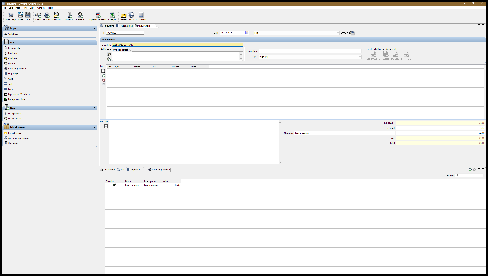
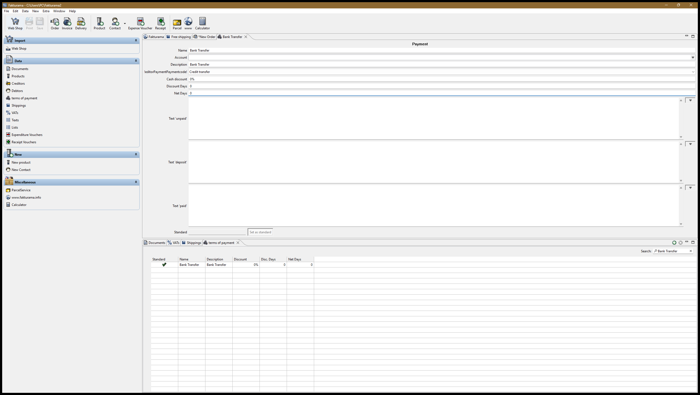
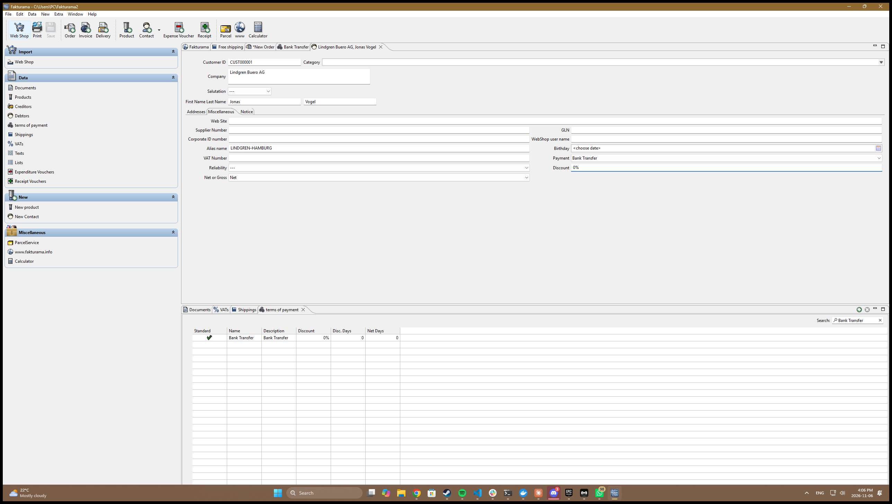
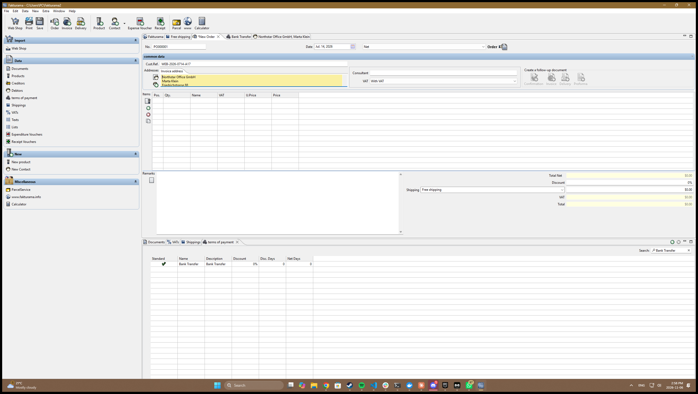
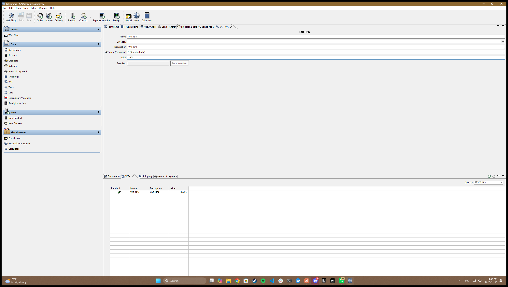
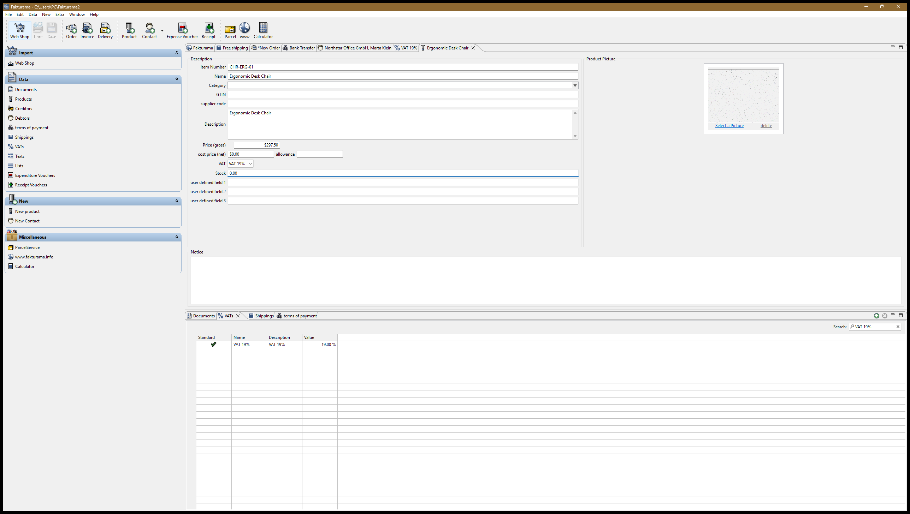
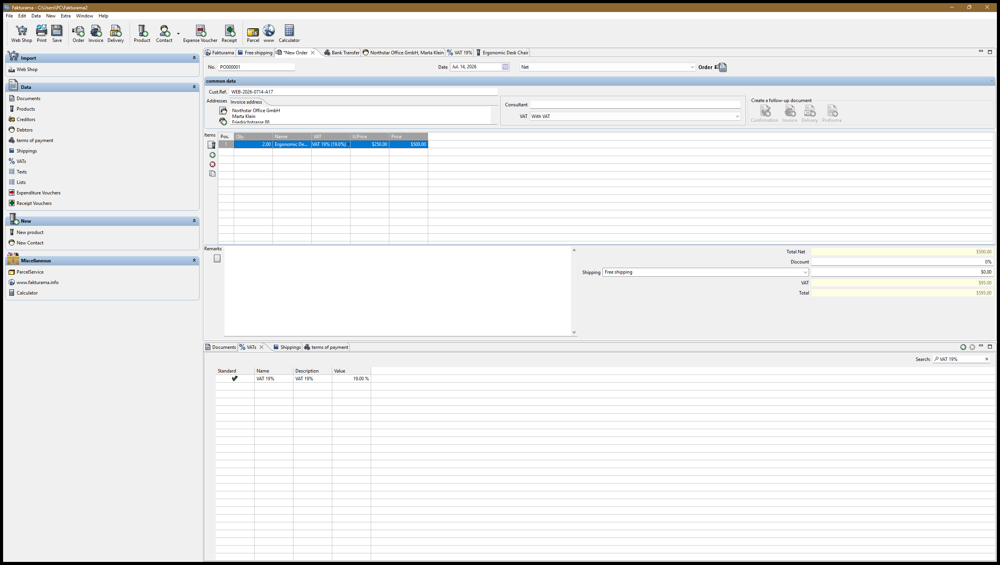

# Annotated run walkthrough

Seven captures from one continuous run of

```powershell
python -m fakturama_automation --image samples\order_sample.png
```

against **Fakturama 2.2.0** on Windows 11, starting from an empty database. The flow takes
one screenshot per completed stage, numbered in execution order; `captions.txt` is the
machine-written index and this page is the annotated version of it.

Each entry says which brief step it corresponds to, what the automation did, and **what to
look at** to check that it did it. Every value shown was written by the automation and read
back before the run moved on — the full evidence trail is in `artifacts/run.log`.

---

## 1 — New Order, header filled



**Brief 1.3–1.8.** The Order is opened *first*, before any master data is touched, and
stays open for the rest of the run.

Look at:

- **No. `PO000001`** — proposed by Fakturama and deliberately left alone (1.4).
- **Date `Jul. 14, 2026`** — the extracted order date (1.5). This control is a segmented
  Nebula `CDateTime`, not a text box; it accepts `07/14/2026` and renders it this way.
- **Cust.Ref. `WEB-2026-0714-A17`** — the extracted external reference (1.6), highlighted
  because it has just been written.
- **`Net`** and **VAT `With VAT`** — the required price mode (1.7).
- The **Items** table and **Addresses** block are still empty, and totals read `$0.00`.
  Nothing has been invented yet.

---

## 2 — Payment method created



**Brief 2.10.1–2.10.6.** The extracted method `Bank Transfer` did not exist, so it was
created from *Data ▸ terms of payment*.

Look at:

- **Name** and **Description** both `Bank Transfer`, **Account** left blank (2.10.3).
- The payment-code dropdown — labelled `!editorPaymentPaymentcode!`, an untranslated key
  this build ships with — set to **`Credit transfer`**. That is the brief's required
  mapping (2.10.4), and that raw label is why the selector matches it by several possible
  captions rather than one.
- **Cash discount `0%`**, **Discount Days `0`**, **Net Days `0`** (2.10.5).
- **Text 'unpaid' / 'deposit' / 'paid'** all blank, and the **Standard** field empty —
  *Set as standard* was never clicked, as 2.10.5 requires.

This step runs *before* the Debtor editor opens. SWT fills a combo when its editor is
constructed, so a term created afterwards never appears in the Debtor's dropdown.

---

## 3 — Debtor created and saved



**Brief 2.5–2.11.** No exact Debtor matched, so one was created while the Order stayed open.

Look at:

- The editor tab reads **`Northstar Office GmbH, Marta Klein`** with **no leading
  asterisk** — Fakturama marks unsaved editors with `*`, so this one has been saved (2.11).
- **Customer ID `CUST000001`** — proposed by Fakturama, left unchanged (2.6).
- **Company**, **First Name `Marta`**, **Last Name `Klein`**, **Salutation `---`** (2.6).
- On **Miscellaneous**: **Alias name `NORTHSTAR-BERLIN`**, **Discount `0%`**,
  **Net or Gross `Net`** (2.9).
- **Payment `Bank Transfer`** — the method created in the previous capture, now selectable
  because it existed before this editor was built (2.10).

The billing address, and its Invoice-address role, are on the **Addresses** tab (2.7–2.8).

---

## 4 — Debtor selected back onto the open Order



**Brief 2.12–2.13, and the most important check in stage 2.**

Look at:

- The **Addresses** block on the Order now reads **Northstar Office GmbH / Marta Klein /
  Friedrichstrasse 88**, highlighted because it has just populated.
- The editor tabs show **`*New Order`** still open alongside the Debtor and payment
  editors — the Order was never closed (1.8).

This matters because the brief treats successful re-selection from the Order as the proof
that the Debtor saved. A Save click is not evidence; finding the record again is. The
automation cancels out of the selector, re-opens it, searches again, and only then accepts
the record as real.

---

## 5 — VAT rate created



**Brief 3.4–3.6.** Checked before the Product is created, so the rate is available in the
Product's VAT dropdown (3.7).

Look at:

- **Name** and **Description** both **`VAT 19%`** — `VAT` followed by the extracted
  percentage.
- **VAT code (E-Invoice) `S (Standard rate)`** (3.6).
- **Value `19%`**, matching the percentage in the name.
- The **VATs** list beneath confirms the persisted row: `VAT 19% · 19.00 %`.

---

## 6 — Product created



**Brief 3.8–3.11.**

Look at:

- **Item Number `CHR-ERG-01`** — the extracted SKU. OCR reads this as `CHR-ERG-OI` in the
  source document's font at every scale; it is corrected from the sibling row's digit
  pattern and the correction is reported, never silent.
- **Name** and **Description** both `Ergonomic Desk Chair` (3.8).
- **Price (gross) `$297.50`** — this is the one calculation to check: unit net `250.00` ×
  `1.19` = `297.50`. The line's **10% discount is deliberately not applied** to the master
  price (3.9).
- **cost price (net) `$0.00`**, **VAT `VAT 19%`**, **Stock `0.00`** (3.10).
- **Category**, **GTIN**, **supplier code**, **allowance**, **Product Picture** and the
  user-defined fields all left untouched (3.10).

---

## 7 — Item line completed, and where the run stops



**Brief 3.12–3.14 succeeded; 3.15 cannot be performed on this build.**

Look at the item line first:

- **Qty `2.00`**, **U.Price `$250.00`**, **VAT `VAT 19% (19.0%)`** — written into the grid
  and read back (3.13–3.14). Fakturama draws this table with Nebula NatTable, which
  publishes no rows at all to UI Automation, so the cell is located by reading the grid's
  own pixels and clicking it; NatTable then opens a real editor to write into.
- **Price `$500.00`**, and **Total Net `$500.00`**, **VAT `$95.00`**, **Total `$595.00`** —
  the grid recalculated correctly from what was entered.
- Every master-data editor is **still open** behind the Order, and **`*New Order`** is
  still there (1.8).

Now look at the **column headers**: `Pos. │ Qty. │ Name │ VAT │ U.Price │ Price`.

**There is no Discount column.** The source document applies **10%** to this line, and
step 3.15 requires entering it. It cannot be entered. *Documents ▸ Use discount for each
item* is already enabled, and toggling it off, on and applying changes nothing; there is no
header or row context menu, and no item-properties dialog.

So the totals above are *arithmetically consistent with what Fakturama was told*, but they
are **not** what the source document says: with the discount the line should be
`2 × 250 × 0.9 = 450.00`, not `500.00`.

The run therefore stops here for manual review, naming the discount it wanted and the
columns it actually found, rather than saving an Order whose totals disagree with the
source. A line carrying **no** discount is noted and the run continues — the block is
specific to a non-zero discount on this build.

---

## What is not shown

Brief stages **4** (save and verify the Order) and **5** (the linked Invoice and its paid
status) are implemented but never reached, because the sample's first line stops the run
above. Pointing the flow at a document whose lines carry no discount would exercise them.
This is stated the same way in the main [README](../../README.md#status-read-this-first).
